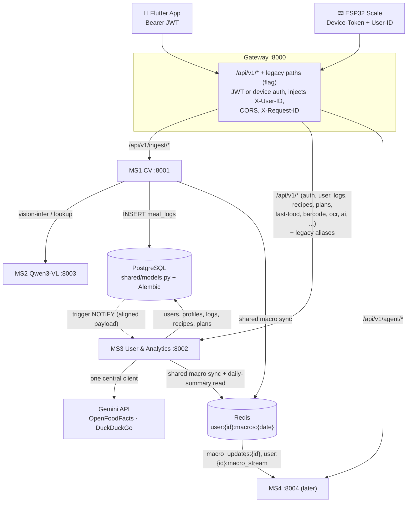

# Phase 5 Execution Tasks — MS3: User & Analytics Service (Port 8002) Integration

> Based on `docs/MASTER_PLAN.md` Phase 5 and `docs/MASTER_ARCHITECTURE.md` (Microservice 3, Layer 2 route table, Flow 1).
> The new MS3 code (now with fast-food support) is feature complete and sits at
> `ms3_user/NutriX-main/NutriX-Regional-MS3-main/`. **This phase is integration, not feature work:** stitch it into the
> NutriX stack (shared DB schema, gateway, auth, Redis) **with the least change to MS3's behaviour**, so the existing app keeps working.
> Goal: *a basic end-to-end pipeline as fast as possible.* Tasks are tagged **P0** (needed to stitch), **P1** (needed before a demo), **P2** (can wait).

## Decisions (confirmed)

| # | Topic | Decision |
|---|---|---|
| 1 | Barcode / OCR / classify | **Stay in MS3.** Gateway routes `barcode/*` and `ocr` to MS3 (the MS1 routes are removed) |
| 2 | AI / web features | **Keep Gemini** in MS3 for the main AI features (coach, diet plan, recipe generator, recipe instructions), barcode estimation and OCR, plus the DuckDuckGo and OpenFoodFacts scrapers. Qwen/MS2 is **not** used by MS3 in this phase. MS3 gets one central Gemini client instead of 7 scattered inline calls |
| 3 | Existing app | The app exists (not on this machine) and worked with the bundled MS3. **Compatibility first:** response shapes and old paths stay working; the app is remodelled afterwards |
| 4 | Scale ↔ account pairing | **None.** The scale keeps sending a static `User-ID` header |
| 5 | Old routes and web dashboard | **Keep old paths as aliases** (the current app calls them) and keep the HTML dashboard as a dev-only page. Remove both later, once the remodelled app uses `/api/v1` |
| 6 | Redis sync | Shared helper `sync_daily_macros()` called by MS1 and MS3, and the Postgres trigger aligned to the same payload |

### What the old routes and the dashboard are (so you can decide when to drop them)
- **Old routes** are the paths MS3 serves today: `/api/auth/login`, `/api/meal-logs`, `/recipes/top`, `/generate-meal-plan`, `/users/{id}/targets`, … They have no `/v1`. The web dashboard (and, we assume, the app) call exactly these. If they disappear, the app breaks until it is rewritten. So we serve both: the new `/api/v1/...` paths (canonical, in the architecture) and the old ones as hidden aliases to the same functions.
- **The dashboard** is `GET /`: a 5,700-line single-page web UI (`app/templates/index.html`) that shipped with MS3. It is a complete test client for every feature (login, scan barcode, meal plans, recipes, water, weight…). It is not reachable through the gateway. It is useful as a **regression harness** and demo, so it stays, served only when `ENV=dev`.

## Compatibility with the current app (do not break)
- Handlers and **response models move unchanged**; only decorators, paths, imports and auth wiring change.
- The web client sends `Authorization: Bearer <token>` on every call and takes the user id from `/auth/me`. So enforcing JWT + "path user id must equal the token's user" is compatible with a client built that way. **To verify** against the real app code (see Open Questions).
- Login/register keep returning `{access_token, token_type, is_new_user, user}`. Only the token's *internal* claims change (`sub` becomes the user id), which the app never reads.
- The dashboard's call list (33 distinct endpoints, below) becomes the **contract test set** (task 5.8.2):
  `/api/auth/{register,login,google,me}`, `/calculate-profile`, `/recommend-foods`, `/users/{id}/{weight-history,meal-plans}`, `/track-weight`, `/generate-meal-plan`, `/recipes/{recommend,filter,top,search,{code}}`, `/api/meal-logs[/today/{id}|/{id}]`, `/api/water-logs[/today/{id}|/{id}]`, `/api/analytics/{id}[/history]`, `/api/homely/builder-defaults`, `/api/homely-meals/{calculate,create,user/{id},search,pending,review/{id}}`, `/api/fast-food/grouped`, `/api/barcode/{code}`, `/api/barcode/{scan-image,manual}`, `/api/ocr`.

---

## Implementation log: delivered and verified on the running stack

Delivered (nothing has been executed by me; see the command list in the chat):

| Area | What exists now |
|---|---|
| **Package** | `ms3_user/`: `main.py` (app, lifespan listener, CORS, request-ID, `/health`, `/dev-ui` in dev), `routes.py` (the 54 converted routes, handler bodies unchanged), `routing.py` (`DualRouter`: every route served at `/api/v1/...` **and** its legacy path), `deps.py` (auth + ownership), `schemas*.py`, `services/` (16 engines + `macro_listener.py`), `tests/` (13 ported files + `conftest.py` + `test_auth_contract.py`), `dev_ui/index.html`, `requirements.txt`, `Dockerfile` |
| **Schema** | `shared/models.py` extended (`is_onboarded`, `water_target_ml`, `recipes.brand/dietary_tag`, `food_categories`, `food_portions`, `food_tags`, `ingredients`, MS3's defaults and `diet_type` fallback); `shared/alembic/versions/002_ms3_regional.py` (idempotent) + canonical, DELETE-aware macro trigger |
| **Auth** | `sub` = numeric user id (+ `email` claim); secret/algorithm/expiry from `.env` (expiry default 720 h = the app's current 30 days); refuses to start without `JWT_SECRET_KEY` unless `ENV=dev`; mock Google tokens only in dev; Google `aud` check; every route authenticated except register/login/google/reset-password and `/health`; ownership enforced on path, query, JSON body, form and delete-by-id |
| **Gateway** | `gateway/router.py` prefix rules for MS3 (new + legacy spellings, flag `ENABLE_LEGACY_ROUTES`), barcode/ocr moved to MS3, AI timeouts 90 s; one `X-Request-ID` from logging middleware to downstream and back; CORS; `gateway/tests/test_router_ms3.py` |
| **Redis** | `shared/macro_sync.py` (canonical payload, `sync_daily_macros`, XADD stream); MS1 and MS3 call it; listener is now cache-only (no duplicate events); `GET /api/v1/user/daily-summary`, `/user/history`, `/user/targets` |
| **MS1** | unknown `User-ID` -> 404 (or created safely with `AUTO_CREATE_DEV_USER=true`, which also fixes the id sequence) |
| **Data** | seeders read only `dataset/ms3_datasets/` and fail loudly; `seed_fast_food.py` (MS3's parser, Postgres target) + dietary-tag backfill; regional recipes tagged from their CSV; `scripts/verify_seed.py`, `scripts/create_dev_user.py` |

**Verification results**
- Database: migration `002` applied (trigger is an AFTER row trigger on INSERT/UPDATE/DELETE); fast food seeded = **3,355 items / 8 chains**; every recipe has a `dietary_tag` (Vegetarian 3,451, Non-Vegetarian 606, Vegan 372, Jain 157); `foods` = 1,886, `recipes` = 4,586.
- Tests: `ms3_user/tests/test_auth_contract.py` **33/33**, `gateway/tests` **45/45**, ported MS3 tests **94 passed, 3 skipped** (the skips need the seeded recipe library, which the throw-away test DB does not have).
- Live journey through the gateway (MS1 + MS2 + MS3 + Redis + Postgres): login `sub`=1 accepted by the gateway and MS3; scan (Qwen fallback, 5.6 s warm-up) -> `meal_logs.source=esp32_qwen_vlm` -> `daily-summary` served from Redis with the scan's macros; manual log -> 2 meals; **delete -> back to 1 meal** (DELETE-aware resync works); no token 401, other user 403, garbage token 401, body-id mismatch 403; legacy paths (`/api/meal-logs/today/1`, `/recipes/top`) work through the gateway; fast-food chains/grouped return the seeded data.
- Bug found by the run: the dev account used `dev@nutrix.local`, which the email validator rejects as reserved; it is now `dev@nutrix.dev`.

**Leftovers round (code written; run the commands in the chat to verify):**
- `ms3_user/services/gemini_client.py`: one client for coach, diet plan, recipe generator, recipe instructions, OCR and barcode (key in the `x-goog-api-key` header, `GEMINI_MODEL` + `GEMINI_FALLBACK_MODELS`, retries, 30 s cooldown after an outage). The AI routes keep their offline fallback and now also return `source: "gemini" | "offline"`; `generate-instructions` returns `503` instead of `400`/`500`.
- `GET /api/v1/user/stream` (SSE) via `ms3_user/services/live_stream.py`; gateway rule with a 120 s read timeout.
- `ms3_user/tests/test_legacy_compat.py` (the dashboard's endpoints on both spellings), `test_gemini_client.py`, `test_live_stream.py`.
- Gateway `GET /health/all`; `scripts/export_openapi.py`, `scripts/cleanup_test_data.py`; `docs/API_CONTRACT.md`; architecture route table updated (barcode/OCR now MS3).
- 5.1.6 (splitting `routes.py`) was **skipped on purpose**: it only moves code between files, while every handler shares helpers (`format_user_profile`, homely formatters...), so the risk is not worth it now.

**Verified (leftovers round):** MS3 suite 159 passed / 2 skipped, gateway 46 passed, OpenAPI exported (57 paths). 5.6.4 was already satisfied (5 s timeouts + User-Agent on OpenFoodFacts/DuckDuckGo; `barcode_cache` read/written).

**AI fallback round:** Gemini failures were caused by retired model names (404) and a brand-new overloaded model (503 + slow reads). The client now caps each attempt at `GEMINI_REQUEST_TIMEOUT` (10 s), moves straight to the next model on a 503 or a slow response, and only stops when Google cannot be reached at all. Behind it sits a real fallback: **MS2 `POST /api/v1/llm/generate`** (local Qwen) via `ms3_user/services/ai_text.py` (Gemini -> local -> canned text, `source` = `gemini` | `local` | `offline`, switch: `AI_LOCAL_FALLBACK`). Tools: `scripts/list_gemini_models.py`.

**Gemini model choice (measured with `scripts/benchmark_gemini.py`):** the 2.x models are retired (404) and the newest full flash models (`3.7`/`3.8`) were overloaded (503 / read timeouts); the thinking models (`3.5`/`3.6` flash, `flash-latest`) took 8-19 s for a coach answer because of 800-1,300 hidden thinking tokens. The lite models answer in 2-4 s with no thinking, so `.env` uses `GEMINI_MODEL=gemini-3.5-flash-lite` with `gemini-flash-lite-latest`, `gemini-3.1-flash-lite`, `gemini-3-flash-preview` as fallbacks. `thinkingBudget` is rejected by these models (400), and no generation-config override is needed. Re-run the benchmark whenever Google retires a model.

**Still open:** 5.0.4 (app source), 5.1.4/5.7.1 (delete the old `ms3_user/NutriX-main/` folder and duplicates after you are satisfied), 5.1.6, 5.3.5-5.3.7, 5.4 admin-only review routes (kept open on purpose), 5.5.7 (cleanup of the old `esp32_smart_scale` test rows), 5.5.8 (SSE), 5.6 (Gemini client), 5.7.4/5.7.6, 5.8.2/5.8.4/5.8.5, 5.9, 5.10.

Deviations from the plan above (and why):
1. **Canonical paths.** Routes that carry a user id keep it (`/api/v1/meal-logs/today/{user_id}`, ownership-checked) instead of becoming `/user/...`; this keeps the existing app a base-URL change away. New current-user routes were added next to them (`/user/daily-summary`, `/user/history`, `/user/targets`). Renames to the architecture names: `/api/ocr` -> `/ocr/upload`, `/generate-meal-plan` -> `/meal-plans/generate`, `/track-weight` -> `/weight-logs`, `/recommend-foods` -> `/foods/recommend`, `/calculate-profile` -> `/user/profile`.
2. **One router file** (5.1.6, the split, is still open).
3. **5.2.3 was a no-op**: no MS3 service queried `FoodAlias.alias`, only the model declared it.
4. **`recipes.dietary_tag` matters.** MS3's recommendation engine filters Jain/Vegan/Vegetarian users with `Recipe.dietary_tag` *in SQL*, so an untagged recipe disappears for them. MS3's ingest script backfilled this; the new seeder does too (plus tags regional recipes from their CSV `Dietary Tag` column).
5. **Tests are isolated** (`ms3_user/tests/conftest.py` forces a throw-away SQLite DB and an unreachable Redis). Run them on their own: `pytest ms3_user/tests`. The 13 ported files were written for an unauthenticated API, so expect some failures that need a token or a user id; they are adapted after the first run.
6. **Kept for later:** the Gemini hardening (5.6), SSE `user/stream` (5.5.8), splitting the router (5.1.6), OpenAPI export and the full 33-endpoint compatibility suite (5.8.2).

---

## 1. Audit: what the new MS3 is, and where it clashes with NutriX

| Area | What MS3 does today | Clash with the current system | Resolution |
|---|---|---|---|
| **Size / layout** | 13.7k lines of Python; `app/main.py` alone is 2,937 lines with 58 routes; 16 engine modules; 13 test files (~63 tests); 55 MB of datasets; 133 Windows `*:Zone.Identifier` junk files | Nested folder; entry must be `ms3_user.main:app` (port 8002). The old `NutriX-main/NutriX-main` is deleted in git | 5.1 |
| **Database layer** | Own `app/db.py` + `app/models.py` (own `Base`); silent SQLite fallback; `create_all()` and SQLite `PRAGMA` auto-migrations at import; default DB name `nutrix` (ours: `nutrix_db`) | Our schema is owned by `shared/models.py` + Alembic. Two `Base`s over the same tables would fight | 5.2 |
| **Schema delta vs `shared/models.py`** | New tables `food_categories`, `food_portions`, `food_tags`, `ingredients`; columns `users.is_onboarded`, `profiles.water_target_ml`, `recipes.brand`, `recipes.dietary_tag` | Missing in Postgres and Alembic | 5.2 |
| **`food_aliases`** | MS3 column `alias`; ours (MS1, MS2, `shared/food_lookup.py`, seeders) is `alias_name` + `language` | MS3 alias queries would fail on Postgres | 5.2 |
| **`meal_logs`** | MS3 model lacks `weight_g`, `source` | MS1 writes both | 5.2, 5.5 |
| **Route paths** | `/api/auth/...`, `/users/{id}/targets`, `/recipes/...`, `/generate-meal-plan`, `/api/health` | Gateway/architecture use `/api/v1/...`; gateway proxies paths unchanged and has no rule for most MS3 routes; health must be `/health` | 5.3 |
| **Auth** | Own JWT, claims `sub=<email>`, `id=<user id>`; secret defaults to `nutrix-super-secret-key-12345`; 30-day expiry; mock Google tokens always accepted; no `aud` check on real Google tokens | Gateway verifies with `jose` and treats `sub` as the **user id**, forwarding it as `X-User-ID` (MS1 does `.isdigit()`). A MS3 token would turn `X-User-ID` into an e-mail | 5.4 |
| **Authorisation** | Only **6 of 58 routes** enforce a user (`auth/me` ×2, `search-history` ×2, `settings` ×2). **51 are unauthenticated** and take `user_id` in the path/body. `GET /users/{email}` looks up any account; `POST /recipes/train-ml` is public | Anyone reaching the port can read or write any user's data | 5.4 |
| **Redis / dashboard** | MS3 reads macros from the DB only | Architecture: Redis read (<10 ms). **Two writers with different payloads** already exist for `user:{id}:macros:{date}`: MS1 writes `protein_g, carbs_g, fat_g, meals_count, latest_item`; the Postgres trigger/`macro_listener` writes `protein, carbs, fat` and no count. Last writer wins. The trigger fires on INSERT/UPDATE only, so a deleted meal never resyncs | 5.5 |
| **MS1 user creation** | n/a | MS1 auto-creates `User(id=<header id>, email=user_<id>@nutrix.local)` with an explicit id; the Postgres id sequence will collide with real registrations | 5.5 |
| **Gemini / web calls** | Gemini REST calls inline in 4 `main.py` endpoints, `ocr_engine.py`, and 2 functions in `barcode_service.py`; model names hardcoded and inconsistent (`gemini-1.5-flash`, `2.0-flash`, `2.5-flash`, `1.5-pro`); the API key travels in the URL query string (ends up in logs). OpenFoodFacts and DuckDuckGo scraping in `barcode_service.py` | Works, but fragile. Kept by decision, so harden rather than replace | 5.6 |
| **Fast food** | 8 chains, 3,355 items stored as `recipes` rows with `brand` + `dietary_tag`; `/api/fast-food/{chains,grouped}`; ingest script hardcoded to `d:/NutriX/...`, writes to SQLite | Not in Postgres; no seeder; cannot run here | 5.7 |
| **Datasets / seeders** | Data in MS3's `Dataset/` and `Food Dataset/` (duplicated). Our `shared/seeders/*` read `ms3_user/NutriX-main/NutriX-main/Dataset` and fall back to `dataset/` | That path no longer exists and `dataset/` has no flat files, so **re-running the seeders silently seeds nothing** | 5.7 |
| **Dependencies** | `ortools`, `xgboost`, `scikit-learn`, `rapidfuzz`, `bcrypt`, `pyjwt`, `joblib` | None are in our `.venv`; `ms3_user/requirements.txt` is the old stub | 5.0, 5.1 |
| **Existing MS3 stub** | `ms3_user/main.py` (health + Postgres `LISTEN macro_update` thread), `services/macro_listener.py`, 1 health test | Must keep working and be merged into the new app | 5.1, 5.5 |

---

## 2. Target integration

**Principles**
1. **One schema owner:** `shared/models.py` + Alembic. MS3 stops owning tables.
2. **One identity:** the JWT `sub` is the numeric user id everywhere. The gateway checks credentials for the outside world; MS3 independently enforces ownership.
3. **One URL contract, two spellings:** canonical `/api/v1/...`, plus the old paths as aliases (same handlers) until the app is remodelled.
4. **One Redis shape:** a single shared helper builds the daily-macro payload (MS1, MS3, DB trigger).
5. **Local models for the scale, cloud for the web-grounded features:** MS1/MS2 stay local; MS3's Gemini/OFF/DDG calls go through one client with timeouts and graceful errors.

---

## 3. Design Decisions

| Topic | Decision |
|---|---|
| **Package layout** | Move into `ms3_user/`: `main.py`, `deps.py`, `routes.py` (see below), `schemas.py`, `schemas_recipes.py`, `services/` (the 16 engines + `macro_listener.py` + `gemini_client.py`), `tests/`, `dev_ui/`. Imports `app.x` → `ms3_user.x`, `models` → `shared.models`. **Fast path:** convert the 58 `@app.` decorators to one `APIRouter` (mechanical) and mount it twice (below). Splitting into several routers is P2 |
| **Two spellings, one handler** | The router is included under `/api/v1` **and** at the old paths, using new canonical paths in the decorators and `add_api_route` aliases (hidden from OpenAPI, `deprecated=True`) for the old ones. Gateway has an `ENABLE_LEGACY_ROUTES` flag (default on) with prefix rules for the old paths |
| **DB** | `shared.db` + `shared.models` only. Delete `app/db.py`, `app/models.py`, `create_all()`, the SQLite `PRAGMA` migrations. Alembic migration `002` adds the delta. Postgres-only at runtime; tests use in-memory SQLite |
| **Alias column** | Keep **`alias_name`**; update MS3's code, not the schema |
| **Token** | `{"sub": "<user id>", "email": ..., "exp": ...}` signed with the shared `JWT_SECRET_KEY` (HS256, same as the gateway); expiry from `JWT_EXPIRY_HOURS`. **Warning:** existing app sessions (old tokens) stop working once; users log in again |
| **Who authenticates** | Gateway validates the JWT and injects `X-User-ID`. MS3 `get_current_user` validates the Bearer token itself and, when `X-User-ID` is present, requires it to equal the token's user |
| **Ownership** | Routes that carry a `user_id` (path or body) keep their shape (compatibility) but are checked: `user_id` must equal the caller or `403`. Body `user_id` is overwritten from the token. New `/user/...` current-user routes carry no id |
| **Redis sync** | `shared/macro_sync.py::sync_daily_macros(db, user_id, date)`: recompute from `meal_logs`, canonical payload, write key, publish `macro_updates:{id}`, `XADD user:{id}:macro_stream`. Called by MS1 and MS3 after every write/delete. Migration `002` aligns the trigger payload and adds DELETE handling |
| **Gemini** | `ms3_user/services/gemini_client.py`: one place for key (`GEMINI_API_KEY`, sent as the `x-goog-api-key` header, never in the URL), model (`GEMINI_MODEL`), timeout, retry/backoff on 429/5xx, JSON-mode helper, and a typed error. No key or failure → `503 {"detail": "AI service unavailable"}` for AI routes; barcode/OCR fall back to the deterministic local steps they already have |
| **Barcode scrapers** | OpenFoodFacts and DuckDuckGo calls stay in `barcode_service.py` (add timeouts and a User-Agent; results already cached in `barcode_cache`) |
| **Fast food** | Seed into Postgres `recipes` (+ `recipe_nutrition`) with `brand` and `dietary_tag`, exactly as MS3 reads them |
| **Datasets** | One canonical location: `dataset/ms3_datasets/` (git-ignored, already used for the YOLO class data). Fast food under `dataset/ms3_datasets/fast_food/` |
| **Scale ↔ user** | Static `User-ID`. MS1 stops auto-creating users (404) unless `AUTO_CREATE_DEV_USER=true`; `scripts/create_dev_user.py` makes user 1 |
| **Dashboard** | Kept at `/dev-ui`, served only when `ENV=dev`, not routed by the gateway |

---

## 4. Route Map. Auth: 🌐 public, 🔑 JWT. "Alias" = the old path that keeps working

| Canonical route (`/api/v1/...`) | Alias (old path) | Auth | Notes |
|---|---|---|---|
| `POST /auth/register` | `/api/auth/register` | 🌐 | token `sub` = user id |
| `POST /auth/login` | `/api/auth/login` | 🌐 | |
| `POST /auth/google` | `/api/auth/google` | 🌐 | verify `aud`; mock tokens only when `ENV=dev` |
| `POST /auth/reset-password` | `/api/auth/reset-password` | 🌐 | still a stub |
| `GET`/`POST /auth/me` | `/api/auth/me` | 🔑 | |
| `PUT /users/{id}` (recompute targets) | `POST /calculate-profile` | 🔑 | id must equal caller |
| `GET /user/targets` | `GET /users/{id}/targets` | 🔑 | |
| `GET /user/weight-history`, `GET /user/meal-plans` | `/users/{id}/weight-history`, `/meal-plans` | 🔑 | |
| **`GET /user/daily-summary`** (new) | — | 🔑 | Redis first, DB fallback, includes targets |
| **`GET /user/history`** (new) | `/api/meal-logs/today/{id}` | 🔑 | `?from=&to=&page=` |
| `GET /user/analytics`, `/user/analytics/history` | `/api/analytics/{id}[/history]` | 🔑 | |
| `GET /user/stream` (new, P2) | — | 🔑 | SSE from Redis `macro_updates:{id}` |
| `POST /meal-logs`, `GET /meal-logs/today`, `DELETE /meal-logs/{id}` | `/api/meal-logs...` | 🔑 | resync Redis on write **and delete** |
| `POST /water-logs`, `GET .../today`, `.../history`, `DELETE .../{id}` | `/api/water-logs...` | 🔑 | |
| `POST /weight-logs`, `DELETE /weight-logs/{id}` | `/track-weight`, `/api/weight-logs/{id}` | 🔑 | |
| `GET /recipes/top`, `/search`, `/{code}` | `/recipes/...` | 🔑 | |
| `POST /recipes/recommend`, `/filter`, `/generate-instructions` | same, `/api/recipes/generate-instructions` | 🔑 | last one uses Gemini |
| `POST /foods/recommend` | `/recommend-foods` | 🔑 | |
| `POST /meal-plans/generate` | `/generate-meal-plan` | 🔑 | OR-Tools, 30 s |
| `GET /fast-food/chains`, `/fast-food/grouped` | `/api/fast-food/...` | 🔑 | |
| `POST /classify`, `/classify/substitutions` | `/api/classify...` | 🔑 | |
| `GET /barcode/{barcode}`, `POST /barcode/scan-image`, `/barcode/manual`, `/barcode/alternatives` | `/api/barcode/...` | 🔑 | routed to MS3 (moved from MS1) |
| `POST /ocr/upload` | `POST /api/ocr` | 🔑 | Gemini vision |
| `/homely/builder-defaults`, `/homely-meals/...` | `/api/homely...` | 🔑 | `pending`/`review` stay open to any logged-in user for now (existing behaviour; noted as debt) |
| `POST /ai/coach`, `/ai/diet-plan`, `/ai/recipe-generator` | `/api/ai/...` | 🔑 | Gemini, 90 s |
| `GET`/`POST /search-history`, `GET`/`PUT /settings` | `/api/search-history`, `/api/settings` | 🔑 | |
| **Removed** | `GET /users/{email}`, `POST /recipes/train-ml`, `GET /` | — | not used by the dashboard: account enumeration, public training trigger, HTML moves to `/dev-ui` |
| `GET /health` (not under `/api/v1`) | `/api/health` | internal | `shared.health.check_health` |

---

## 5. Tasks

### 5.0 Prerequisites and Cleanup (user-run; I will give the exact commands)
- [x] **P0** 5.0.1 Install MS3 dependencies into the WSL `.venv`: `ortools xgboost scikit-learn rapidfuzz bcrypt pyjwt joblib` (verify with `pip list`)
- [x] **P0** 5.0.2 Delete the 133 `*:Zone.Identifier` files under `ms3_user/`
- [x] **P0** 5.0.3 Back up Postgres (`pg_dump`) before migration `002` and re-seeding
- [ ] **P1** 5.0.4 Place a copy (or path) of the Flutter app so its API calls can be checked against the route map

### 5.1 Move MS3 into the `ms3_user` package
- [x] **P0** 5.1.1 Move engines to `ms3_user/services/` (next to `macro_listener.py`), `schemas*.py`, tests; rewrite imports `app.*` → `ms3_user.*`, `models` → `shared.models`, `get_db` → `shared.db.get_db`
- [x] **P0** 5.1.2 Convert `app/main.py` into one `APIRouter` (decorators `@app.` → `@router.`, bodies unchanged)
- [x] **P0** 5.1.3 New `ms3_user/main.py`: lifespan (macro listener start/stop), router included under `/api/v1` and as legacy aliases, `/health` via `shared.health.check_health(include_redis=True)`, CORS (`CORS_ORIGINS`), request-ID middleware, `/dev-ui` only when `ENV=dev`
- [ ] **P0** 5.1.4 Remove `Base.metadata.create_all`, `PRAGMA` auto-migrations, the `.env` loader that overrides `os.environ`, ngrok/shortcut/`run.py`/`append_js.py` scripts, duplicate `Food Dataset/`, hardcoded Google client id
- [x] **P0** 5.1.5 `ms3_user/requirements.txt` (real dependency set: stub deps + the five from 5.0.1 + `python-multipart`, `Pillow`, `PyJWT`); `ms3_user/Dockerfile`; `docker-compose.yml` `ms3-user` env, `/health` healthcheck, `depends_on` postgres + redis
- [ ] **P2** 5.1.6 Split the single router into several by the section banners in `main.py`
- [x] **P1** 5.1.7 `.gitignore`: `*:Zone.Identifier`, `ms3_user/**/output/`, `*.pkl`

### 5.2 Database unification
- [x] **P0** 5.2.1 Port the delta into `shared/models.py`: `User.is_onboarded`, `Profile.water_target_ml`, `Recipe.brand`, `Recipe.dietary_tag`, new `FoodCategory`, `FoodPortion`, `FoodTag`, `Ingredient`; keep `FoodAlias.alias_name`
- [x] **P0** 5.2.2 Alembic `shared/alembic/versions/002_ms3_regional.py`: new columns/tables (nullable or defaulted so existing rows survive); backfill `is_onboarded = true` for users who already have a profile
- [x] **P0** 5.2.3 Replace every `FoodAlias.alias` in MS3 with `alias_name`
- [x] **P0** 5.2.4 Confirm no `sqlite3` / SQLite-only code remains in `ms3_user/`
- [x] **P0** 5.2.5 Verify: `alembic upgrade head` on a copy first, then the real DB; check the changed tables

### 5.3 API contract and gateway
- [x] **P0** 5.3.1 Canonical paths and legacy aliases per the route map; delete the three removed routes
- [x] **P0** 5.3.2 Gateway `router.py`: replace per-route MS3 entries with prefix rules: public auth routes first, then JWT rules for the user-scoped namespaces (new and legacy spellings, legacy behind `ENABLE_LEGACY_ROUTES`). Timeouts: `ai/*` 90 s, `ocr` 30 s, `meal-plans/generate` 30 s, barcode 30 s. **Move `barcode/*` and `ocr` from MS1 to MS3**
- [x] **P0** 5.3.3 Gateway: one request ID (today the logging middleware's ID differs from the forwarded one), returned as `X-Request-ID`; CORS (`CORS_ORIGINS`) for Flutter web
- [x] **P1** 5.3.4 Update `gateway/tests/test_gateway.py` for the new rules (public vs JWT, MS3 routing, legacy on/off, removed paths → 404)
- [x] **P1** 5.3.5 `GET /health/all` on the gateway (aggregates MS1–MS4) for the runbooks
- [x] **P1** 5.3.6 Update `docs/MASTER_ARCHITECTURE.md` route table and barcode/OCR ownership; mark `tasks3.md` barcode/OCR items as "moved to MS3"
- [x] **P2** 5.3.7 `scripts/export_openapi.py` → `docs/api/openapi_ms3.json`

### 5.4 Identity, authentication and authorisation
- [x] **P0** 5.4.1 `auth_service.py`: tokens with `sub=str(user.id)` + `email`; secret/algorithm/expiry from env; **refuse to start** with the default secret unless `ENV=dev`
- [x] **P0** 5.4.2 `deps.py::get_current_user` (Bearer validation, user by id, `X-User-ID` consistency) and `require_owner(user_id)`
- [x] **P0** 5.4.3 Require `get_current_user` on every route except the four public auth routes and `/health`; enforce ownership on every route that carries a `user_id`; overwrite body `user_id` from the token
- [x] **P1** 5.4.4 Google sign-in: verify `aud == GOOGLE_CLIENT_ID` and `iss`; mock tokens only when `ENV=dev`
- [x] **P1** 5.4.5 `/auth/reset-password`: never print a live reset link outside `ENV=dev`
- [x] **P0** 5.4.6 Gateway ↔ MS3 compatibility test: a token from `/auth/login` passes the gateway and the user id arrives as `X-User-ID`

### 5.5 Data flow: MS1, MS3, Postgres, Redis
- [x] **P0** 5.5.1 `shared/macro_sync.py`: canonical payload (`user_id, date, calories, protein_g, carbs_g, fat_g, meals_count, latest_item, updated_at`) and `sync_daily_macros(...)` (key, publish, `XADD` with `MAXLEN`)
- [x] **P0** 5.5.2 MS1 calls it instead of its inline Redis block; MS3 meal-log create/delete/update call it
- [x] **P0** 5.5.3 Migration `002`: replace `notify_macro_update()` with the canonical keys and fire on DELETE (use `OLD`); the listener then writes the same shape
- [x] **P0** 5.5.4 `GET /user/daily-summary` (Redis → DB fallback + targets, percent, remaining) and `GET /user/history` (range + pagination)
- [x] **P1** 5.5.5 Manual meal logs record `weight_g` and `source` (`manual` | `fast_food` | `barcode` | `homely` | `recipe`); extend `MealLogCreate` with optional fields (backwards compatible)
- [x] **P0** 5.5.6 MS1: unknown `X-User-ID` → 404 unless `AUTO_CREATE_DEV_USER=true`; `scripts/create_dev_user.py` registers user 1 (and fixes the id sequence with `setval`)
- [x] **P1** 5.5.7 Update `scripts/reset_test_session.py`, `show_redis_cache.py`, `show_db_logs.py` for the canonical payload and new `source` values; cleanup script for the old test rows (users created by MS1, `esp32_smart_scale` rows with negative/huge weights)
- [x] **P2** 5.5.8 SSE `GET /user/stream` from the Redis channel (heartbeat; gateway must not buffer or time out the read)

### 5.6 Gemini and web-source hardening (keep, centralise)
- [x] **P1** 5.6.1 `ms3_user/services/gemini_client.py`: key from `GEMINI_API_KEY` via the `x-goog-api-key` header, model from `GEMINI_MODEL`, timeouts, retry with backoff on 429/5xx, JSON-mode helper, typed error
- [x] **P1** 5.6.2 Replace the inline calls: `recipes/generate-instructions`, `ai/coach`, `ai/diet-plan`, `ai/recipe-generator` (in `main.py`), `ocr_engine.py`, and the two Gemini functions in `barcode_service.py`; remove the hardcoded model names and keys-in-URL
- [x] **P1** 5.6.3 No key or upstream failure → `503 {"detail": "AI service unavailable"}` on AI routes; barcode/OCR degrade to their deterministic local steps
- [x] **P1** 5.6.4 `barcode_service.py`: explicit timeouts and User-Agent for OpenFoodFacts and DuckDuckGo; confirm `barcode_cache` is read and written
- [x] **P2** 5.6.5 Optional offline fallback: when Gemini is unavailable, ask MS2 `/api/v1/llm/lookup` for the nutrition estimate (MS2 already supports it)
- [x] **P1** 5.6.6 Add `GEMINI_MODEL` to `.env.example`

### 5.7 Datasets, seeding and fast food
- [ ] **P0** 5.7.1 Copy the data files from MS3's `Dataset/` and `Fast Food/` into `dataset/ms3_datasets/` (fast food under `fast_food/`), verify checksums, then remove the duplicates
- [x] **P0** 5.7.2 Point `shared/seeders/seed_foods.py`, `seed_portions.py`, `seed_recipes.py` (and `seed_aliases.py`) at `dataset/ms3_datasets/` only; **fail loudly** if an expected file is missing
- [x] **P0** 5.7.3 `shared/seeders/seed_fast_food.py`: port `ingest_fast_food_dataset.py` to SQLAlchemy/Postgres (no `d:/`, no `sqlite3`); upsert `recipes` (`brand`, `dietary_tag`, `recipe_code=FF_<CHAIN>_<n>`) + `recipe_nutrition`; idempotent
- [ ] **P1** 5.7.4 Port the differences from MS3's `seed_custom_data.py` into `seed_rules.py`; add `food_portions` / `food_tags` / `ingredients` seeders only if the engines read them
- [x] **P0** 5.7.5 Register in `run_all_seeders.py`; `scripts/verify_seed.py` prints row counts and checks fast food = **3,355 items / 8 chains**
- [ ] **P1** 5.7.6 Confirm MS1/MS2 food lookup is unaffected by the new rows

### 5.8 Tests and CI
- [x] **P0** 5.8.1 Port the 13 MS3 test files into `ms3_user/tests/` (imports, `shared.models`, in-memory SQLite with only the needed tables, like `ms2_llm/tests/conftest.py`); they must pass before anything else is called done
- [x] **P0** 5.8.2 Contract tests from the dashboard call list: each of the 33 endpoints answers on **both** its old and `/api/v1` path with the same response shape
- [ ] **P1** 5.8.3 New tests: ownership (user A cannot read/write user B on every route), token ↔ gateway, `daily-summary` Redis hit/miss/fallback, canonical payload, delete resync, fast-food diet filters, Gemini routes with a mocked client, `503` degradation
- [ ] **P1** 5.8.4 `ms3_user/tests/test_health.py` passes without Postgres/Redis; `ci-ms3.yml` installs the new requirements
- [ ] **P2** 5.8.5 Boot time (< 5 s) and memory check

### 5.9 App readiness (contract only)
- [x] **P1** 5.9.1 `docs/API_CONTRACT.md`: auth flow (register/login/Google → Bearer), error body, dates/units, the old→new path map, base-URL change (app → gateway `:8000`, no code change needed while legacy aliases are on)
- [ ] **P1** 5.9.2 Verify the real app against the route map (needs 5.0.4); list gaps
- [ ] **P2** 5.9.3 Pagination shape, SSE usage, upload limits (barcode/OCR), what the backend still lacks for the app (HitL confirm, push)

### 5.10 Runbooks and docs
- [ ] **P1** 5.10.1 `docs/testing/PIPELINE_2_SOFTWARE.md`: add MS3 and a user journey (register → login → scan with `dev_capture` → `daily-summary` → manual log → delete → summary updates)
- [ ] **P1** 5.10.2 `docs/testing/PIPELINE_1_HARDWARE.md`: dev user creation and the `User-ID` the scale must send
- [x] **P1** 5.10.3 `.env.example`: `ENV`, `CORS_ORIGINS`, `GOOGLE_CLIENT_ID`, `AUTO_CREATE_DEV_USER`, `ENABLE_LEGACY_ROUTES`, `GEMINI_MODEL`
- [ ] **P1** 5.10.4 Tick Phase 5 in `docs/MASTER_PLAN.md`, update `AI_CONTEXT.md`, remove the empty `ms3_user/NutriX-main/` folder

---

## 6. Order (vertical slices; each ends with something you can run)

1. **Boot slice (P0):** 5.0, 5.1, 5.2 → MS3 starts on Postgres, `/health` green, old tests ported and green (5.8.1).
2. **Identity slice (P0):** 5.4.1–5.4.3, 5.3.1–5.3.3 → register/login **through the gateway** on both path spellings; ownership enforced.
3. **Dashboard slice (P0):** 5.5 → scan with `dev_capture`, `daily-summary` shows it; manual log/delete update Redis; MS1 no longer creates users.
4. **Data slice (P0):** 5.7 → recipes, fast food and regional data in Postgres; recipe, meal-plan and fast-food routes work.
5. **Contract slice (P0/P1):** 5.8.2 → the 33-endpoint compatibility suite is green.
6. **Hardening (P1/P2):** 5.6, 5.3.4–5.3.6, 5.9, 5.10, then P2 items.

---

## 7. Open Questions
1. **App source.** The app is not on this machine. Can you put a copy (or just its `lib/` API layer) in the repo, or give me the path? Until then, compatibility is based on the bundled dashboard, which sends the Bearer token on every call. If the app calls any route without a token, enforced auth will return 401 for it and I would need to know.
2. **Existing logins.** Switching the token claim to the user id invalidates sessions once (users log in again). Acceptable?

## Out of Scope (deferred)
- HitL confirmation, per-user YOLO adapters (tasks3); MS4 agents consuming the macro stream (Phase 6); push notifications
- MS3 → MS2 for AI features (kept on Gemini by decision); `llm/generate` in MS2 (arrives with MS4 in Phase 6)
- Refresh tokens / revocation, rate limiting, real e-mail for password reset, admin roles for homely-meal review
- The `HomelyMeal` ⇄ `Recipe` merge and other ORM refactors from `MASTER_PLAN` technical debt
- Writing the Flutter screens (Phase 7)
