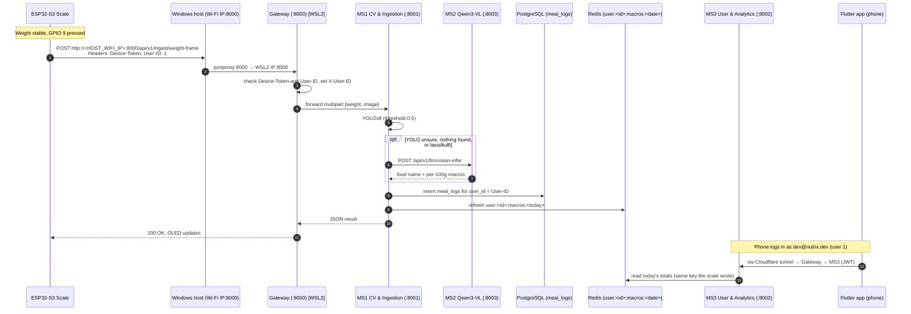

# NutriX Pipeline 1: Hardware Testing Runbook

> **ESP32-S3 Smart Scale → Gateway (:8000) → MS1 Vision (:8001) → [MS2 Qwen3-VL fallback (:8003)] → PostgreSQL → Redis → MS3 (:8002) → Flutter app (via Cloudflare tunnel)**

This is the complete runbook for testing with the physical **ESP32-S3 smart scale** (HX711 load cell, OV2640 camera, SSD1306 OLED, push button on GPIO 9) and the **Flutter app** on your phone. Follow it top to bottom the first time. Every command runs in the **WSL2 Ubuntu** terminal unless a step says PowerShell.

Repo: `/home/harsh/Nutrix` (WSL). Windows path: `\\wsl.localhost\Ubuntu\home\harsh\Nutrix`.

---

## 0. Before you start (checklist)

| You need | Where it comes from |
|---|---|
| Scale powered, flashed, and on the same Wi-Fi as the laptop | Section 8 |
| Laptop and phone on the internet (the phone reaches the backend through Cloudflare, not the LAN) | Section 9 |
| `cloudflared` installed on Windows (`winget install Cloudflare.cloudflared`, then open a **new** PowerShell window) | Section 9 |
| `.env` at the repo root with `DEVICE_TOKEN`, `AUTO_CREATE_DEV_USER`, `APP_TIMEZONE`, `ENV=dev` | Section 3.1 |
| Dev account `dev@nutrix.dev` (id **1**) | Section 3.4 |

---

## 1. How the pieces connect



**The scale never logs in.** It has no password and no JWT. It identifies the account with the `User-ID` header, which must be the numeric id of the account you want the meals to land on.

---

## 2. Which account does a scale meal go to?

This is the question from testing, answered from the code:

1. **The firmware chooses it.** Every request carries a `User-ID` header. The firmware (not the backend) decides the value. The sketch in Section 8 sets `USER_ID = "1"`.
2. **The gateway requires it.** A request without `User-ID` gets `400 Missing User-ID header`. The gateway forwards it to MS1 as `X-User-ID`.
3. **MS1 uses it as the database user id.** `ms1_cv/main.py` (`_resolve_scale_user`) turns `User-ID: 1` into `user_id = 1` on the `meal_logs` row and the Redis key `user:1:macros:<date>`.
4. **The app shows whichever account is logged in.** The app's JWT carries the account's id as `sub`. MS3 reads the same Redis key and database rows for that id.

So a meal is visible in the app only when **the scale's `User-ID` equals the logged-in account's id**. Today `dev@nutrix.dev` is id **1**, so the firmware sends `User-ID: 1`.

| Case | What happens |
|---|---|
| `User-ID: 1` and `dev@nutrix.dev` is id 1 | Meal shows on the dev account in the app. This is the setup for testing. |
| `User-ID: 1` but another account is id 1 | Meal goes to that other account. Check with the SQL in 3.4. |
| `User-ID` not a number (for example a MAC address, as older docs suggested) | With `AUTO_CREATE_DEV_USER=true`, MS1 silently falls back to **user 1**. With `false` it gets `400`. Use a number. |
| `User-ID` is a number with no account (for example `99`) | With `AUTO_CREATE_DEV_USER=true`, MS1 creates a placeholder user `99`. With `false` it gets `404 Unknown user`. |
| Phone logged in as a different account than the scale's `User-ID` | The meal is logged, but the app will not show it. |

To test with a different person's account later, register that person (`POST /api/v1/auth/register`), read their id, and set `USER_ID` in the firmware to that number. There is no pairing step.

---

## 3. Environment preparation (WSL2)

### 3.1 Check `.env`
Open `/home/harsh/Nutrix/.env` and confirm these values (secrets not shown here):

| Key | Must be |
|---|---|
| `DEVICE_TOKEN` | The exact value the firmware sends. Current value: the one in `.env` (starts `NutriX_ESP32_SECURE_TOKEN_`). |
| `AUTO_CREATE_DEV_USER` | `true` for bench testing (lets a scale create an unknown user; see Section 2). |
| `ENV` | `dev` (enables `/dev-ui` on MS3 and the dev JWT-secret default). |
| `APP_TIMEZONE` | `Asia/Kolkata`. "Today" is computed here for every service. |
| `VLM_MODEL_PATH` | The Qwen3-VL snapshot folder (MS2). |
| `YOLO_CONF_THRESHOLD` | `0.5` |
| `DATABASE_URL`, `REDIS_URL` | Already set. Do not change. |

Quotes are fine: the loaders strip them.

### 3.2 Start PostgreSQL and Redis
```bash
cd /home/harsh/Nutrix
docker compose up -d postgres redis
docker compose ps
```
Expect `nutrix-postgres` on `5432` and `nutrix-redis` on `6379`, both healthy. If you get `Database connection refused` later, these are not running.

### 3.3 Activate the virtual environment
Every Python command below assumes this is done in the terminal:
```bash
cd /home/harsh/Nutrix
source .venv/bin/activate
```
Every Python command also needs `PYTHONPATH=.` in front of it, as shown below.

First time only, or after a dependency change:
```bash
pip install -r requirements.txt
pip install -r ms1_cv/requirements.txt -r ms2_llm/requirements.txt -r ms3_user/requirements.txt
python -c "import transformers, accelerate, qwen_vl_utils, torch; print('VLM deps OK, CUDA:', torch.cuda.is_available())"
```

### 3.4 Database schema, prompts, and the dev account
```bash
PYTHONPATH=. alembic upgrade head                      # MS3 columns/tables and the canonical macro trigger
PYTHONPATH=. python shared/seeders/seed_prompts.py     # MS2 prompt rows
PYTHONPATH=. python scripts/create_dev_user.py         # creates / updates id 1 = dev@nutrix.dev
```

`create_dev_user.py` prints the account it created or updated. Default password is `nutrix123`. To use your own:
```bash
PYTHONPATH=. python scripts/create_dev_user.py --id 1 --email dev@nutrix.dev --password 'Pass@123' --name "Dev User"
```

**Verify the binding** (the account with the id the scale sends):
```bash
docker compose exec -T postgres psql -U nutrix -d nutrix_db -c "SELECT id, email, is_active FROM users WHERE id = 1 OR email = 'dev@nutrix.dev';"
```
Expected: one row, `id = 1`, `email = dev@nutrix.dev`. If `dev@nutrix.dev` has a different id, either rerun the script with `--id <that id>` and set the firmware `USER_ID` to match, or move the account. Do not guess; the id must match.

### 3.5 Reset test data (clean state)
Run before every test session so earlier runs do not leave negative or huge totals:
```bash
PYTHONPATH=. python scripts/reset_test_session.py --user-id 1
```
This deletes today's `meal_logs` rows for user 1 and sets `user:1:macros:<today>` to `0.0 kcal` in Redis. Add `--all-dates` to delete all history for that user.

### 3.6 Unit tests (optional, before a hardware session)
```bash
PYTHONPATH=. pytest ms1_cv/tests ms2_llm/tests gateway/tests -q --tb=short -p no:warnings
PYTHONPATH=. pytest ms3_user/tests -q --tb=short -p no:warnings
```
Both suites use their own throw-away databases. MS3 tests do not touch `dev@nutrix.dev`.

---

## 4. Start the backend (four WSL2 terminals)

Start in this order. MS2 is slow (about 30 s to load the model), so start it first.

### Terminal A: MS2 Vision-Language service (port 8003). **No `--reload`.**
```bash
cd /home/harsh/Nutrix && source .venv/bin/activate
PYTHONPATH=. uvicorn ms2_llm.main:app --host 0.0.0.0 --port 8003
```
Ready when `curl -s localhost:8003/health` shows `"vlm": {"status": "ok", ...}`. Never add `--reload`: each reload reloads the ~4 GB model from `/mnt/c`.

### Terminal B: MS1 Vision and Ingestion (port 8001)
```bash
cd /home/harsh/Nutrix && source .venv/bin/activate
PYTHONPATH=. uvicorn ms1_cv.main:app --host 0.0.0.0 --port 8001 --reload
```
Expect `Application startup complete.`

### Terminal C: MS3 User and Analytics (port 8002)
```bash
cd /home/harsh/Nutrix && source .venv/bin/activate
PYTHONPATH=. uvicorn ms3_user.main:app --host 0.0.0.0 --port 8002 --reload
```
Expect `Application startup complete.` With `ENV=dev`, the test client is at <http://localhost:8002/dev-ui>.

### Terminal D: API Gateway (port 8000). This is the only port the scale and the tunnel use.
```bash
cd /home/harsh/Nutrix && source .venv/bin/activate
PYTHONPATH=. uvicorn gateway.main:app --host 0.0.0.0 --port 8000 --reload
```
The startup log lists the MS1/MS2/MS3/MS4 URLs, all `http://localhost:800x`.

### Health check of all services
```bash
for p in 8000 8001 8002 8003 8004; do
  printf "%s  " $p; curl -s -m 5 localhost:$p/health | python -c "import sys,json; d=json.load(sys.stdin); print(d['service'], d['status'])" 2>/dev/null || echo "DOWN"
done
```
Expected: gateway, MS1, MS2 and MS3 `ok`. MS4 is `DOWN` by design (it is not built yet). Also check the gateway's aggregate view:
```bash
curl -s localhost:8000/health/all
```

---

## 5. Pre-flight test without the hardware

Confirm the whole chain works through the gateway before you involve the scale. This simulates the scale with a saved image:
```bash
cd /home/harsh/Nutrix && source .venv/bin/activate
TOKEN=$(grep '^DEVICE_TOKEN=' .env | cut -d= -f2- | tr -d '"')
PYTHONPATH=. python scripts/dev_capture.py --image inference_outputs/latest_raw.jpg --weight 150 \
  --url http://localhost:8000/api/v1/ingest/weight-frame --token "$TOKEN" --user-id 1 --no-browser
```
Expected: `identified_by` and `macro_source` in the output, plus a new row in the database:
```bash
PYTHONPATH=. python scripts/show_db_logs.py
PYTHONPATH=. python scripts/show_redis_cache.py
```
Also check the MS3 side with the dev account's token (MS3 must show the same total):
```bash
curl -s -H "Authorization: Bearer <paste-access-token>" "localhost:8000/api/v1/user/daily-summary"
```
Get `<paste-access-token>` from the app (or from `/dev-ui` after logging in). If the total matches Redis, the chain is correct.

---

## 6. Expose the backend to the phone (Cloudflare tunnel)

The phone is not on the laptop's LAN, so the app reaches the gateway through a public HTTPS tunnel. The **scale does not use the tunnel**; it uses the LAN IP (Section 7). Only the app does.

### 6.1 Start the tunnel (PowerShell, after the four services are up)
```powershell
cloudflared tunnel --url http://localhost:8000
```
> `cloudflared` runs on Windows, so `localhost:8000` reaches the WSL2 gateway (WSL2 forwards localhost by default). If it fails with `connection refused`, the gateway is not running yet.

It prints a line like:
```
https://<random-words>.trycloudflare.com
```
Keep this window open. Copy the URL.

### 6.2 Test the tunnel from your phone's browser
Open `https://<random-words>.trycloudflare.com/health/all` in mobile Chrome. You should see the JSON health list. If you get an error page from Cloudflare, the tunnel has stopped.

### 6.3 Important: the URL changes on every tunnel run
A free `trycloudflare.com` URL is new each time `cloudflared` starts. Every time it changes:
1. Give the new URL to the app developer (or set it in your app's base-URL config).
2. Rebuild the app handoff zip with the new URL:
   ```bash
   cd /home/harsh/Nutrix && source .venv/bin/activate
   PYTHONPATH=. python scripts/make_app_handoff.py --base-url https://<random-words>.trycloudflare.com --password 'Pass@123'
   cp dist/nutrix_app_handoff.zip /mnt/c/Users/HP/Desktop/
   ```
   The zip never includes `.env` (it holds the handoff docs and the API contract only).
3. Re-test login from the phone.

---

## 7. Find the Windows LAN IP and forward port 8000 (one-time per PC restart or Wi-Fi change)

The scale reaches the gateway at the **laptop's Wi-Fi IP**. Windows forwards that to WSL2, which has its own internal IP.

### 7.1 Laptop Wi-Fi IP (PowerShell)
```powershell
ipconfig
```
Find **Wireless LAN adapter Wi-Fi → IPv4 Address** (for example `192.168.29.232`). This is `<HOST_WIFI_IP>`.

### 7.2 WSL2 internal IP (PowerShell)
```powershell
wsl -d Ubuntu -- bash -c "ip -4 addr show eth0 | grep -oP '(?<=inet\s)\d+(\.\d+){3}'"
```
Example `172.25.48.117`. This is `<WSL_IP>`.

### 7.3 Port forwarding and firewall (PowerShell **as Administrator**)
```powershell
# Remove an old rule if it points at a previous WSL IP (ignore the error if none exists)
netsh interface portproxy delete v4tov4 listenport=8000 listenaddress=0.0.0.0

# Forward the Wi-Fi port 8000 to the gateway in WSL2
netsh interface portproxy add v4tov4 listenport=8000 listenaddress=0.0.0.0 connectport=8000 connectaddress=<WSL_IP>

# Allow the port through Windows Firewall (run once; ignore "already exists")
netsh advfirewall firewall add rule name="NutriX Gateway 8000" dir=in action=allow protocol=TCP localport=8000
```
Verify:
```powershell
netsh interface portproxy show v4tov4
```

### 7.4 Confirm the scale can reach the gateway (from another device on the Wi-Fi)
From your phone's browser on the same Wi-Fi (not the tunnel):
`http://<HOST_WIFI_IP>:8000/health`. You should see the gateway's JSON. If it does not load, the firewall or portproxy is wrong.

---

## 8. ESP32-S3 firmware configuration and flashing

The firmware sketch is not in this repo. Set these constants in your Arduino sketch:

```cpp
const char *ssid         = "YOUR_WIFI_SSID";
const char *password     = "YOUR_WIFI_PASSWORD";
const char *SERVER_HOST  = "<HOST_WIFI_IP>";                 // Section 7.1, e.g. 192.168.29.232
const uint16_t SERVER_PORT = 8000;                          // gateway port
const char *DEVICE_TOKEN = "<exact DEVICE_TOKEN from .env>"; // must match .env character-for-character
const char *USER_ID      = "1";                             // numeric account id; see Section 2
```

Every weight-frame POST must send **both** headers and the two form fields (`weight`, `image`):

```cpp
HTTPClient http;
http.setTimeout(40000);                                       // fallback path can take 3–6 s; keep ≥ 15 s
http.begin(client, String("http://") + SERVER_HOST + ":" + SERVER_PORT + "/api/v1/ingest/weight-frame");
http.addHeader("Device-Token", DEVICE_TOKEN);
http.addHeader("User-ID", USER_ID);                           // without this the gateway answers 400
// multipart body: field "weight" (text, grams) and field "image" (JPEG bytes)
```

> If your sketch uses a different HTTP client, keep the same two header names and the same two form-field names.

Flash:
1. Connect the ESP32-S3 by USB-C, pick the board and port in Arduino IDE, click **Upload**.
2. Open **Serial Monitor** at `115200` baud.
3. The OLED should show:
   ```text
   +--------------------+
   |   NUTRIX SCALE     |
   |   SYSTEM READY     |
   | Press button GPIO9 |
   +--------------------+
   ```

Firmware timeout: the Arduino default (often 5 s) is too short when the VLM fallback runs. Set it to at least 15 s (40 s recommended).

---

## 9. Run a live capture

1. **Tare:** make sure the tray is empty or tared.
2. **Place food:** for example an apple. Wait 1–2 s for the reading to settle.
3. **Press GPIO 9.**
4. **Check each place:**

| Where | Expected |
|---|---|
| ESP32 Serial Monitor | `HTTP 200` and the JSON body |
| OLED | Food name, weight, kcal, confidence (for example `Bell Pepper`, `38.3 g`, `38.3 kcal`) |
| Terminal D (gateway) | `POST /api/v1/ingest/weight-frame` 200 |
| Terminal B (MS1) | `[CV Engine] Processing event: stable weight = …` then `[Database] Logged meal #N: <food> … for user 1` then `[Redis] Synced user:1:macros:<today>` |
| Browser | `http://localhost:8001/captures/annotated` shows the YOLO box |
| Phone app (logged in as `dev@nutrix.dev`) | Today's calories and the meal appear on the dashboard. Pull to refresh if the live stream is not open. |

If the OLED is right but the app is not, check the account binding in Section 2 first.

### 9.1 VLM fallback test
| Place on the scale | Expected |
|---|---|
| Something YOLO knows well (apple, banana, bread) | Fast (~100 ms). `identified_by: yolo`, `meal_logs.source = esp32_yolo`. MS2 stays idle. |
| Something YOLO cannot place (unusual dish, poor light, empty plate) | 3–6 s. OLED shows the Qwen name. `identified_by: qwen`, `source = esp32_qwen_vlm` |
| Lassi or kulfi | Suppressed on purpose. Qwen names it. `reason` shows `Suppressed class: …` |
| MS2 stopped | HTTP 200, `macro_source: llm-timeout`, 0 kcal. Start MS2 and check again. |

The **Conf** value for Qwen items is the model's own estimate, not a calibrated probability.

---

## 10. Inspection tools

| Tool | Command | Shows |
|---|---|---|
| Annotated capture | <http://localhost:8001/captures/annotated> | YOLO box and banner |
| Raw capture | <http://localhost:8001/captures/latest> | Camera JPEG |
| Meal logs | `PYTHONPATH=. python scripts/show_db_logs.py` | Recent meals, weight, kcal, source, user |
| Redis totals | `PYTHONPATH=. python scripts/show_redis_cache.py` | Today's totals per user |
| MS2 audit | `docker compose exec -T postgres psql -U nutrix -d nutrix_db -c "SELECT id, operation, confidence, latency_ms, flagged, created_at FROM audit_logs WHERE service='ms2' ORDER BY id DESC LIMIT 10;"` | One row per vision call |
| Foods added by Qwen | `docker compose exec -T postgres psql -U nutrix -d nutrix_db -c "SELECT f.name, n.energy_kcal FROM foods f JOIN food_nutrients n ON n.food_id=f.id WHERE f.brand='LLM Inferred' ORDER BY f.id DESC LIMIT 10;"` | Foods the VLM added |

---

## 11. Troubleshooting

| Symptom | Cause | Fix |
|---|---|---|
| ESP32: `Could not connect to API Gateway` | WSL2 IP changed after reboot, or portproxy missing | Repeat Section 7.2 and 7.3 with the new `<WSL_IP>` |
| Gateway returns `400 Missing User-ID header` | Firmware not sending `User-ID` | Add the header (Section 8) and reflash |
| Gateway returns `401 Invalid Device-Token` (OLED: `HTTP 401`) | Token in sketch differs from `.env` | Copy `DEVICE_TOKEN` from `.env` into the sketch exactly |
| MS1 returns `404 Unknown user N` | `AUTO_CREATE_DEV_USER=false` and no account with id N | Register that account, or set `AUTO_CREATE_DEV_USER=true` and restart MS1 |
| Meal logged but not in the app | Scale `User-ID` ≠ logged-in account id | Check the SQL in 3.4; match the id in the firmware |
| Meal logged under user 1 unexpectedly | Non-numeric `User-ID` (for example a MAC) with `AUTO_CREATE_DEV_USER=true` | Use the numeric id in the sketch |
| `macro_source: llm-timeout`, 0 kcal | MS2 down or still loading | `curl localhost:8003/health`; start MS2 and wait for `vlm.status: ok` |
| OLED shows a failure but the meal IS in the database | Firmware timeout shorter than the fallback path | Raise the HTTP timeout to ≥ 15 s (40 s recommended) |
| Calories negative or huge in Redis | Leftover test data | `PYTHONPATH=. python scripts/reset_test_session.py --user-id 1` |
| YOLO says `Unknown` or low confidence | Light or camera angle | Check `http://localhost:8001/captures/latest`; MS2 names the item if YOLO fails |
| `CUDA out of memory` in MS1 or MS2 | 6 GB GPU shared by both | Close other GPU apps, or set `VLM_KEEP_LOADED=false` in `.env` and restart MS2 |
| `Database connection refused` on startup | Containers not running | `docker compose up -d postgres redis` |
| App shows `Could not connect` or login fails | Tunnel stopped or URL changed | Restart Section 6.1; use the new URL (Section 6.3) |
| App gets `502 Bad Gateway` | MS3 not running (the gateway routes app calls to it) | Start Terminal C; check `localhost:8002/health` |
| Tunnel shows `connection refused` | Gateway not running | Start Terminal D first, then the tunnel |

---

## 12. Clean shutdown

1. **Stop the services:** `Ctrl + C` in Terminals A (MS2, frees ~4 GB VRAM), B (MS1), C (MS3) and D (gateway).
2. **Stop the tunnel:** `Ctrl + C` in the PowerShell window running `cloudflared`.
3. **Stop containers** (keeps the data):
   ```bash
   docker compose down
   ```
   Do not add `-v`, which deletes PostgreSQL data.
4. **Optional, PowerShell as Administrator:**
   ```powershell
   netsh interface portproxy delete v4tov4 listenport=8000 listenaddress=0.0.0.0
   ```
