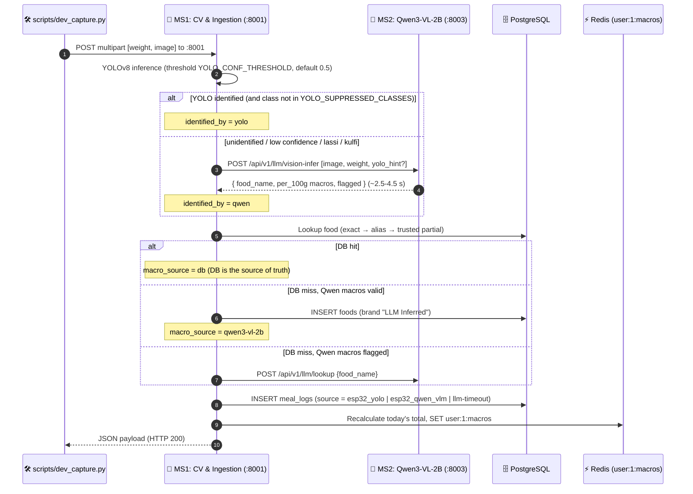

# NutriX Pipeline 2: Software-Only Testing Runbook
> **Webcam / Test Images $\rightarrow$ `scripts/dev_capture.py` $\rightarrow$ [Gateway :8000] $\rightarrow$ MS1 Vision (:8001) $\rightarrow$ [MS2 Qwen3-VL fallback (:8003)] $\rightarrow$ PostgreSQL $\rightarrow$ Redis $\rightarrow$ Web Viewer**

This document is the complete step-by-step developer runbook for testing NutriX **entirely in software** without requiring the physical ESP32-S3 scale, load cells, or Windows portproxy configuration. It covers every service that currently does real work: **Gateway, MS1, MS2**, plus health checks for MS3 and MS4 (still stubs).

---

## 1. Why Pipeline 2?

| Feature | Pipeline 1 (Hardware) | Pipeline 2 (Software Mode) |
|---|---|---|
| **Hardware Required** | ESP32-S3, HX711, Camera, OLED | **None** (Laptop webcam or sample images) |
| **Gateway Required** | Yes (Device-Token auth) | **Optional** (direct to MS1 at `:8001`, or through `:8000` to test auth/routing) |
| **Port Forwarding / IP** | Requires `netsh portproxy` & Wi-Fi IP | **None** (pure `localhost`) |
| **Speed of Iteration** | 1–2 minutes per test | **Seconds** (one CLI command) |
| **Ideal For** | Final system integration & demos | **Daily backend, CV & VLM development** |

---

## 2. Pipeline Architecture & Data Flow



---

## 3. Service Map

| Service | Port | Entrypoint | Status | Needed for |
|---|---|---|---|---|
| **Gateway** | 8000 | `gateway.main:app` | Working | Auth/routing tests (optional) |
| **MS1 CV & Ingestion** | 8001 | `ms1_cv.main:app` | Working | **Always** |
| **MS3 User & Analytics** | 8002 | `ms3_user.main:app` | Health + Redis macro listener only | Optional |
| **MS2 LLM / VLM** | 8003 | `ms2_llm.main:app` | Working | VLM fallback |
| **MS4 Multi-Agent** | 8004 | `ms4_agents.main:app` | Health only (stub) | Optional |
| PostgreSQL / Redis | 5432 / 6379 | docker compose | Working | **Always** |

> Without MS2 running, unidentified frames still log, but with `macro_source: "llm-timeout"` and **0 kcal** (no invented calories).

---

## 4. Environment Preparation

### Step 4.1: Start PostgreSQL & Redis
```bash
cd /home/harsh/Nutrix
docker compose up -d postgres redis
docker ps        # nutrix-postgres and nutrix-redis should be "healthy"
```

### Step 4.2: Activate the virtual environment
```bash
cd /home/harsh/Nutrix
source .venv/bin/activate
```

### Step 4.3: One-time checks
```bash
# VLM dependencies present
python -c "import transformers, accelerate, qwen_vl_utils, torch; print('VLM deps OK, CUDA:', torch.cuda.is_available())"

# Model snapshot readable (path comes from VLM_MODEL_PATH in .env)
ls "$(grep '^VLM_MODEL_PATH=' .env | cut -d= -f2)/model.safetensors"

# Database seeded (expect a few thousand rows) and v2 prompts present
docker exec nutrix-postgres psql -U nutrix -d nutrix_db -c "SELECT count(*) AS foods FROM foods;"
PYTHONPATH=. python shared/seeders/seed_prompts.py
```

### Step 4.4: Run the unit tests (no GPU / model / Postgres needed)
```bash
PYTHONPATH=. pytest ms2_llm/tests ms1_cv/tests gateway/tests -v
```

### Step 4.5: Reset session data (clean state)
```bash
PYTHONPATH=. python scripts/reset_test_session.py
```

---

## 5. Starting the Services

Use one WSL2 terminal per service. **Start MS2 first**: it needs ~30 s to load the model.

### Terminal 1: MS2 (Qwen3-VL-2B). No `--reload`
```bash
cd /home/harsh/Nutrix && source .venv/bin/activate
PYTHONPATH=. uvicorn ms2_llm.main:app --host 0.0.0.0 --port 8003
```
Each reload would re-read the ~4 GB model from `/mnt/c` (~30 s), so never use `--reload` here. Ready when `curl -s localhost:8003/health` shows `"vlm": {"status": "ok"}`.

### Terminal 2: MS1
```bash
cd /home/harsh/Nutrix && source .venv/bin/activate
PYTHONPATH=. uvicorn ms1_cv.main:app --host 0.0.0.0 --port 8001 --reload
```

### Terminal 3: Gateway (optional)
```bash
cd /home/harsh/Nutrix && source .venv/bin/activate
PYTHONPATH=. uvicorn gateway.main:app --host 0.0.0.0 --port 8000 --reload
```
The Gateway's startup log lists the four downstream URLs. All should be `http://localhost:800x`.

### Terminal 4: MS3 User & Analytics (accounts, dashboard, recipes, fast food, barcode, AI)
```bash
cd /home/harsh/Nutrix && source .venv/bin/activate
PYTHONPATH=. uvicorn ms3_user.main:app --host 0.0.0.0 --port 8002 --reload
```
With `ENV=dev` in `.env`, the old web dashboard is served at <http://localhost:8002/dev-ui> (a complete test client for MS3). MS4 is still a health-only stub (`PYTHONPATH=. uvicorn ms4_agents.main:app --port 8004`).

### One-time database steps for MS3 (see `docs/tasks/tasks5.md`)
```bash
PYTHONPATH=. alembic upgrade head                       # adds the MS3 columns/tables and the canonical macro trigger
PYTHONPATH=. python shared/seeders/run_all_seeders.py   # needs the datasets in dataset/ms3_datasets/ (it fails loudly if not)
PYTHONPATH=. python scripts/verify_seed.py              # row counts; fast food must be 3,355 items / 8 chains
PYTHONPATH=. python scripts/create_dev_user.py          # account #1 (dev@nutrix.dev / nutrix123) = the scale's default User-ID
```

### Health check of everything
```bash
for p in 8000 8001 8002 8003 8004; do
  printf "%s  " $p; curl -s -m 5 localhost:$p/health | python -c "import sys,json; d=json.load(sys.stdin); print(d['service'], d['status'])" 2>/dev/null || echo "DOWN"
done
```
`healthy` or `degraded` is acceptable (`degraded` usually means Redis fell back to in-memory, or the MS2 model isn't loaded).

### GPU memory (measured on the RTX 3050 6 GB)
| State | VRAM |
|---|---|
| MS2 model resident (allocated by PyTorch) | ~4,058 MB (peak ~4,116 MB during inference) |
| `nvidia-smi` total with MS2 up | ~4,274–4,368 MiB (≈ 71 %) |
| Inference latency | 2.5–4.5 s (first call includes warm-up) |
| Cold load from `/mnt/c` | ~32 s |

Watch the combined footprint with MS1 running too:
```bash
watch -n 1 nvidia-smi --query-gpu=memory.used,memory.total --format=csv,noheader
```
If you hit CUDA out-of-memory, set `VLM_KEEP_LOADED=false` in `.env` and restart MS2 (loads per call, slower but frees VRAM).

---

## 6. Test Matrix (run in order)

Every `dev_capture.py` result prints **Identified By** (`yolo` / `qwen`) and **Macro Source** (`db` / `qwen3-vl-2b` / `llm-timeout` / `none`). Add `--no-browser` to skip opening the viewer.

| # | Scenario | Command | Expected |
|---|---|---|---|
| A | **YOLO-known food** (clear apple/banana photo) | `PYTHONPATH=. python scripts/dev_capture.py --image inference_outputs/latest_raw.jpg --weight 180 --no-browser` | `Identified By: yolo`, `Macro Source: db`, ~100 ms, no MS2 call |
| B | **Unidentified / low-confidence frame** | send a frame YOLO scores below `YOLO_CONF_THRESHOLD` (default 50 %) (dim, cluttered, or unusual dish) | `Identified By: qwen`, `Macro Source: db` (name matched a DB food) or `qwen3-vl-2b` (new food saved) |
| C | **Suppressed class** (a frame YOLO calls lassi/kulfi) | send a lassi/kulfi-looking frame | `YOLO Reason: Suppressed class: lassi ...`, `Identified By: qwen` |
| D | **MS2 down** | stop Terminal 1, repeat B | HTTP 200, `Macro Source: llm-timeout`, `Calories: 0.0` (MS2 call fails fast on connection refused) |
| E | **Text lookup, DB hit** | `PYTHONPATH=. python scripts/test_ms2.py --lookup banana` | `"source": "db"`, < 50 ms |
| F | **Text lookup, miss then persisted** | `PYTHONPATH=. python scripts/test_ms2.py --lookup "murgh makhani"` twice | 1st: `source: qwen3-vl-2b` (~2 s). 2nd: `source: db` |
| G | **Direct MS2 vision** | `PYTHONPATH=. python scripts/test_ms2.py --image inference_outputs/latest_raw.jpg --weight 180` | label + per-100 g macros; `flagged: true` + `flag_reason` when calories don't match macros |
| H | **Full MS1 → MS2 path via script** | `PYTHONPATH=. python scripts/test_ms2.py --image <frame.jpg> --weight 200 --via-ms1` | same JSON as MS1 payload, GPU usage printed before and after |


### User journey through the Gateway (MS3 + MS1 + Redis)
```bash
GW=http://localhost:8000
# 1. log in (token's `sub` is the numeric user id)
TOKEN=$(curl -s -X POST $GW/api/v1/auth/login -H "Content-Type: application/json" \
  -d '{"email":"dev@nutrix.dev","password":"nutrix123"}' | python -c "import sys,json; print(json.load(sys.stdin)['access_token'])")
# 2. the dashboard before a scan (Redis, falls back to the DB)
curl -s $GW/api/v1/user/daily-summary -H "Authorization: Bearer $TOKEN" | python -m json.tool
# 3. a scale scan for the same user (device-token route)
DEV=$(grep '^DEVICE_TOKEN=' .env | cut -d= -f2)
PYTHONPATH=. python scripts/dev_capture.py --image inference_outputs/latest_raw.jpg --weight 150 --user-id 1 \
  --url $GW/api/v1/ingest/weight-frame --token "$DEV" --no-browser
# 4. the dashboard again: calories went up, `latest_item` is the scanned food
curl -s $GW/api/v1/user/daily-summary -H "Authorization: Bearer $TOKEN" | python -m json.tool
# 5. a manual log, then history, then delete it and watch the totals drop
curl -s -X POST $GW/api/v1/meal-logs -H "Authorization: Bearer $TOKEN" -H "Content-Type: application/json" \
  -d '{"user_id":1,"food_name":"Banana","meal_type":"Snack","calories":105,"weight_g":118}'
curl -s "$GW/api/v1/user/history?page_size=5" -H "Authorization: Bearer $TOKEN" | python -m json.tool
# 6. ownership: asking for another user's data must be 403, no token must be 401
curl -s -o /dev/null -w "other user -> %{http_code}\n" $GW/api/v1/water-logs/today/2 -H "Authorization: Bearer $TOKEN"
curl -s -o /dev/null -w "no token   -> %{http_code}\n" $GW/api/v1/user/daily-summary
# 7. the old paths the existing app uses still work through the gateway
curl -s "$GW/api/meal-logs/today/1" -H "Authorization: Bearer $TOKEN" | python -m json.tool
```

### More MS3 checks (live stream, health, Gemini, cleanup)
```bash
# one call for every service
curl -s $GW/health/all | python -m json.tool

# live dashboard: keep this open in one terminal...
curl -N -s $GW/api/v1/user/stream -H "Authorization: Bearer $TOKEN"
# ...and in another, log or delete a meal: a new `event: summary` frame appears; `: ping` every 15 s

# AI features (Gemini). `source` says whether the answer came from Gemini or the offline fallback
curl -s -X POST $GW/api/v1/ai/coach -H "Authorization: Bearer $TOKEN" -H "Content-Type: application/json"   -d '{"message":"How much protein should I eat today?"}' | python -m json.tool

# export the OpenAPI spec for the app team, and tidy junk scale rows (dry-run first)
PYTHONPATH=. python scripts/export_openapi.py
PYTHONPATH=. python scripts/cleanup_test_data.py
PYTHONPATH=. python scripts/cleanup_test_data.py --apply
```

### Through the API Gateway
```bash
# Device-token route (what the ESP32 uses)
TOKEN=$(grep '^DEVICE_TOKEN=' .env | cut -d= -f2)
PYTHONPATH=. python scripts/dev_capture.py --image inference_outputs/latest_raw.jpg --weight 150 \
  --url http://localhost:8000/api/v1/ingest/weight-frame --token "$TOKEN" --no-browser

# Wrong / missing token must be rejected
curl -s -o /dev/null -w "no token -> %{http_code}\n" -X POST localhost:8000/api/v1/ingest/weight-frame
curl -s -o /dev/null -w "bad token -> %{http_code}\n" -X POST -H "Device-Token: nope" -H "User-ID: 1" localhost:8000/api/v1/ingest/weight-frame
curl -s -o /dev/null -w "good token, no User-ID -> %{http_code}\n" -X POST -H "Device-Token: $TOKEN" localhost:8000/api/v1/ingest/weight-frame

# JWT routes (MS2 text lookup via the gateway)
JWT=$(PYTHONPATH=. python -c "from gateway.generate_token import get_test_token; print(get_test_token())")
curl -s -X POST localhost:8000/api/v1/llm/lookup -H "Authorization: Bearer $JWT" \
  -H "Content-Type: application/json" -d '{"food_name":"paneer tikka"}'
curl -s -o /dev/null -w "llm/lookup without JWT -> %{http_code}\n" -X POST localhost:8000/api/v1/llm/lookup \
  -H "Content-Type: application/json" -d '{"food_name":"x"}'

# Unknown route -> 404; stopped service -> 502
curl -s localhost:8000/api/v1/nope
```
Expected: `401` for a missing or invalid device token / JWT, `400` when a device request has no `User-ID` header, `404` for unknown routes, `502` if the target service is down, `504` on timeout.

---

## 7. `dev_capture.py` Modes

### Mode A: Laptop Webcam (interactive)
WSL2 cannot see the laptop webcam without USB pass-through. Run from **Windows PowerShell**, which talks to MS1 on `localhost:8001`:
```powershell
cd C:\MAIN\Project\CalCount
python scripts\dev_capture.py --webcam
```
Press **SPACE** to capture, enter a weight (or Enter for 150 g), **Q** to quit.

### Mode B: Single image
```bash
PYTHONPATH=. python scripts/dev_capture.py --image inference_outputs/esp32.jpg --weight 180.0
```
Example output (illustrative values):
```text
=================================================================
         NUTRIX INGEST RESULT (HTTP 200 OK)
=================================================================
  • Status          : identified
  • Food Identified : Idli
  • Identified By   : qwen  (yolo = CV model, qwen = MS2 fallback)
  • Macro Source    : db  (db / qwen3-vl-2b / llm-timeout / none)
  • YOLO Reason     : Low confidence: dosa at 22.4% (Required: 30.0%)
  • Confidence      : 95.0%
  • Weight          : 180.0 g
  • Calories        : 252.0 kcal
  • Session ID      : a3d89f21-789a-4c21-b391-7681fbb41290
  • Latency         : 3120.4 ms
=================================================================
```
> For Qwen results, **Confidence** is the model's self-reported value, not a calibrated probability. Treat it as indicative only.

### Mode C: Batch folder
```bash
PYTHONPATH=. python scripts/dev_capture.py --images inference_outputs/ --weight 150.0
```

### Flags
| Flag | Default | Description |
|---|---|---|
| `--webcam` | `False` | Interactive laptop webcam mode |
| `--image <file>` | `None` | Single image |
| `--images <dir>` | `None` | Batch directory |
| `--weight <grams>` | `None` | Preset weight (skips the prompt) |
| `--default-weight <grams>` | `150.0` | Default when prompted |
| `--prompt-weight` | `False` | Force the weight prompt |
| `--url <endpoint>` | `http://localhost:8001/...` | Target (point at `:8000` for the gateway) |
| `--user-id <id>` | `1` | `x-user-id` header |
| `--token <token>` | `None` | `device-token` header (required via the gateway) |
| `--no-browser` | `False` | Don't open the viewer |
| `--reset` | `False` | Reset today's meal logs & Redis before starting |

---

## 8. Result Inspection & Verification

```bash
# Latest meal logs (note the Source column: esp32_yolo / esp32_qwen_vlm / llm-timeout)
PYTHONPATH=. python scripts/show_db_logs.py

# Redis live macro cache
PYTHONPATH=. python scripts/show_redis_cache.py

# Foods the LLM added (brand "LLM Inferred"), newest first
docker exec nutrix-postgres psql -U nutrix -d nutrix_db -c \
  "SELECT f.name, f.food_code, n.energy_kcal, n.protein_g, n.carb_g, n.fat_g FROM foods f JOIN food_nutrients n ON n.food_id=f.id WHERE f.brand='LLM Inferred' ORDER BY f.id DESC LIMIT 10;"

# MS2 audit trail (written for each vision/lookup call)
docker exec nutrix-postgres psql -U nutrix -d nutrix_db -c \
  "SELECT id, operation, confidence, latency_ms, flagged, left(output_summary::text,80) AS output, created_at FROM audit_logs WHERE service='ms2' ORDER BY id DESC LIMIT 10;"

# Which meals came from which identifier
docker exec nutrix-postgres psql -U nutrix -d nutrix_db -c \
  "SELECT source, count(*), round(sum(calories)::numeric,1) AS kcal FROM meal_logs GROUP BY source;"
```
Visual viewer (browser): [annotated](http://localhost:8001/captures/annotated) · [raw](http://localhost:8001/captures/latest). Qwen-identified frames have no bounding box, so the label is drawn as a banner across the top.

### Reset
```bash
PYTHONPATH=. python scripts/reset_test_session.py
```
To remove test foods the LLM invented: `DELETE FROM foods WHERE brand='LLM Inferred';` (cascades to nutrients and aliases).

---

## 9. Troubleshooting

| Symptom | Cause | Fix |
|---|---|---|
| `macro_source: llm-timeout`, 0 kcal | MS2 not running, still loading, or `MS2_LLM_URL` wrong | `curl localhost:8003/health`; wait for `vlm.status: ok` |
| MS2 `/health` says `degraded`, `vlm.status: not_loaded` | Model failed to load (see `vlm.error`) | Check `VLM_MODEL_PATH`; `pip install` the VLM deps; read the MS2 terminal |
| CUDA out of memory | MS1 + MS2 + other GPU apps exceed 6 GB | Close other GPU apps, or `VLM_KEEP_LOADED=false` |
| Vision result `flagged: true`, `calories` inconsistent | 2B model's kcal doesn't match its macros (e.g. idli 240 kcal vs 3.5/32/2 g) | Expected occasionally. MS1 ignores flagged macros and uses the DB entry or `/llm/lookup` |
| Same wrong label every time for lassi/kulfi | Class not in suppression list | Add it to `YOLO_SUPPRESSED_CLASSES` in `.env` and restart MS1 |
| Gateway `502 Bad Gateway` | Target service not running | Start it; check the URL log line at gateway startup |
| Gateway `504` | Service exceeded route timeout (weight-frame: 60 s) | Check MS2 isn't stuck; worst-case Qwen path is ~35 s |
| First MS2 request slow | Normal warm-up | Send one throwaway request after start |
| Negative / huge Redis totals | Stale test data | `scripts/reset_test_session.py` |

---

## 10. Daily Checklist

```bash
# Infra
docker compose up -d postgres redis
source .venv/bin/activate

# Services (one terminal each)
PYTHONPATH=. uvicorn ms2_llm.main:app --host 0.0.0.0 --port 8003              # no --reload
PYTHONPATH=. uvicorn ms1_cv.main:app  --host 0.0.0.0 --port 8001 --reload
PYTHONPATH=. uvicorn gateway.main:app --host 0.0.0.0 --port 8000 --reload     # optional

# Ingest
PYTHONPATH=. python scripts/dev_capture.py --image inference_outputs/latest_raw.jpg --weight 150 --no-browser

# Inspect
PYTHONPATH=. python scripts/show_db_logs.py
PYTHONPATH=. python scripts/show_redis_cache.py
```
